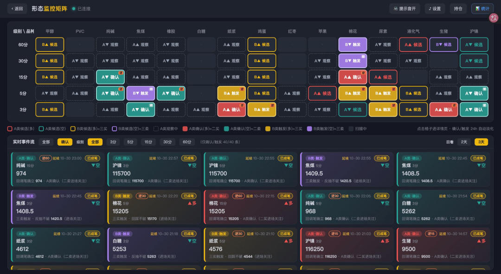
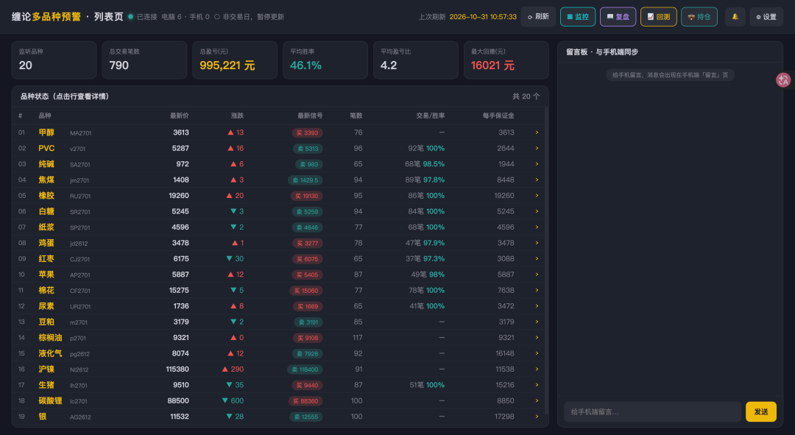
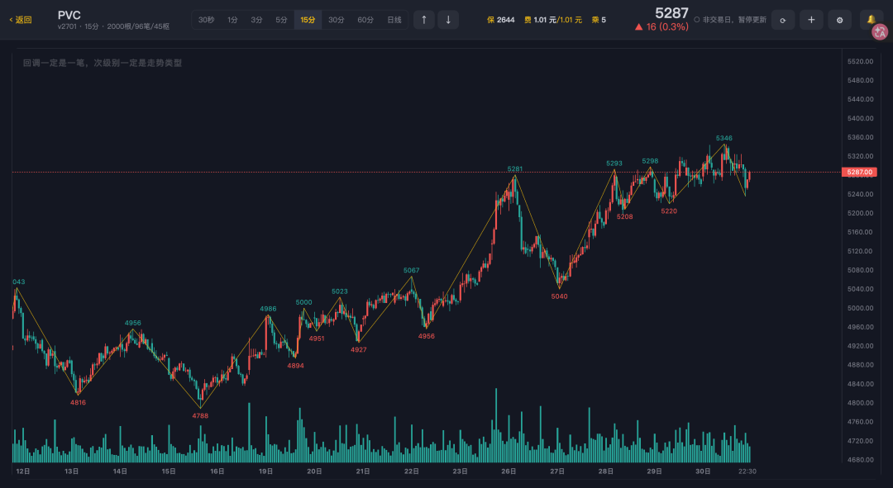
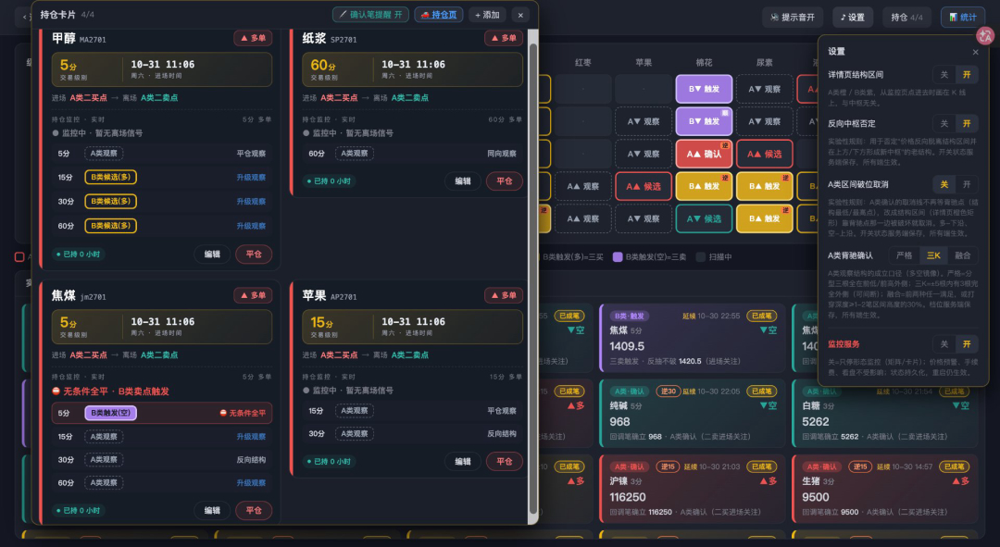
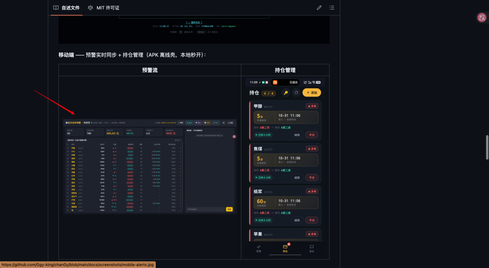
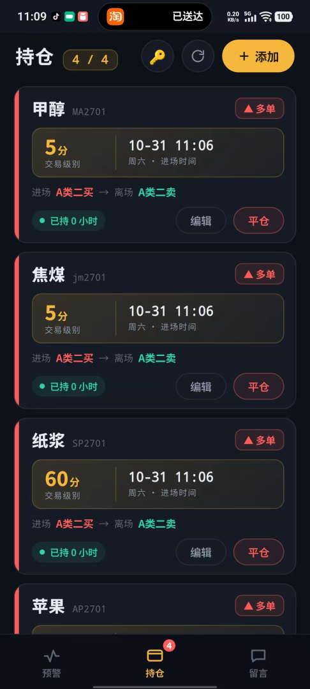
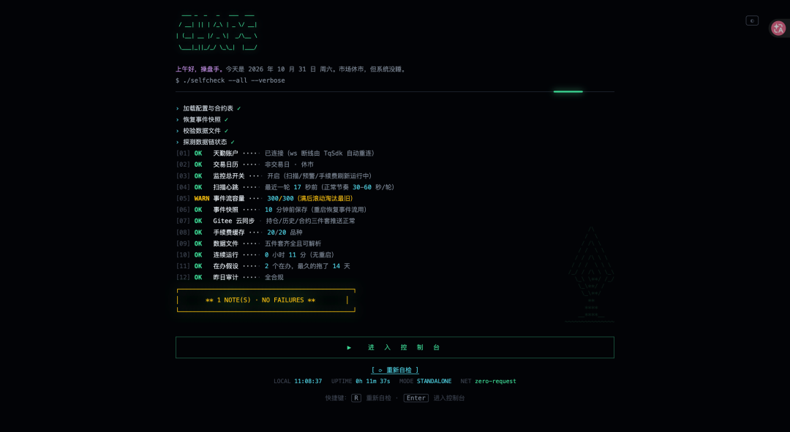
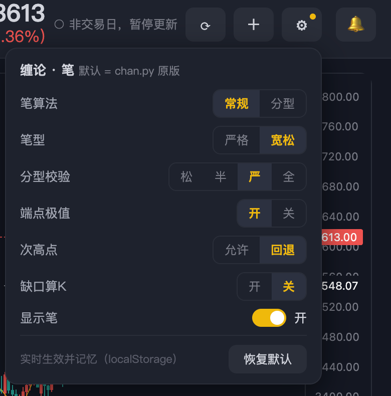
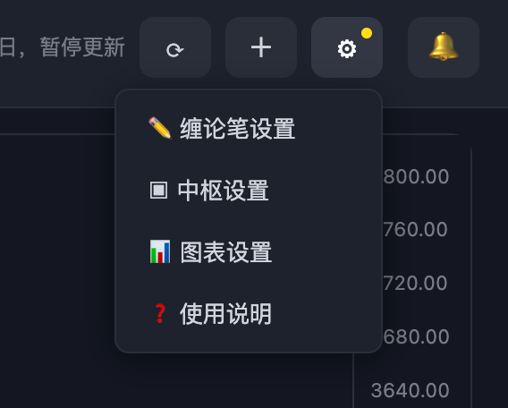

<div align="center">

# chanGy

**缠论期货看盘与预警系统 · 单人 + AI 协作开发的全链路实践(仅开源部分代码)**

`Python 3.12` `FastAPI` `WebSocket` `天勤 TqSdk` `akshare` `lightweight-charts` `Playwright` `Android 离线壳`

[](LICENSE)


</div>

---

chanGy 是一套**本地运行、单端口、三端覆盖**的缠论期货看盘与预警系统，围绕一条完整的形态识别流水线构建：

- **数据层**：天勤 TqSdk 实时行情（K线推送，任意周期）、akshare 手续费与保证金数据、新浪交易日历
- **识别层**：K线包含合并 → 顶底分型 → 笔 → 中枢 → 买卖点（A类趋势反转 / B类三买三卖），纯形态学口径，多级别联立
- **监控层**：20 品种 × 全级别矩阵式扫描，信号状态机（观察 → 候选 → 确认 → 触发 → 失效）全生命周期管理，事件流实时推送
- **交互层**：PC 端 9 个页面 + 全键盘操作 + 四窗多级别同屏，移动端 H5 与 Android APK 离线壳
- **纪律层**：三价出场体系（硬止损 / 保本 / 止盈锚）、平仓阻尼拦截、三级复盘审计、AI 周复盘分析（可选）
- **同步层**：Gitee 私有仓库作为数据权威源，PC / 移动端双端最终一致

系统内建缠论参数配置面板，笔算法 / 笔型 / 分型校验 / 端点极值 / 次高点处理 / 缺口算K 等参数与 [chan.py](https://github.com/Vespa314/chan.py) 口径对齐（默认即 chan.py 原版配置），实时生效并记忆。

---

## 界面总览

### 形态监控矩阵

全品种 × 全级别实时状态网格。行是级别（60分 / 30分 / 15分 / 5分 / 3分），列是品种，每个格子对应一个信号状态机实例：无信号（A▲ 观察）、候选（B■ 候选）、确认（▲▼ 确认）、触发、失效。底部图例将全部状态编码为颜色，盘面上任何结构性变化在矩阵中即时可见。

矩阵下方为实时事件流：每一次信号状态跃迁均以卡片形式滚动记录——「焦煤 3分 B类候选 → 确认」「白银 5分 触发后失效」，完整保留信号从出现到消亡的生命周期，复盘时按事件流回溯当日盘面结构变化。



支撑该页面的性能治理是项目的代表性工程：全品种全级别逐级计算缠论结构，信号流按分钟持续产出，WebSocket 长连接需在盘中持续保鲜。早期版本存在盘中周期性卡顿，定位为断线清订阅 × 锁内重登记 × 全局锁竞争的结构性问题后，实施四层治理（快照兜底 / 点击插队 / 用户限频 / 锁内重登记改造），事件流刷新频率由每分钟 85 次降至 17 次，卡顿消除。

### 多品种列表页

列表页回答的是落地问题：今天该看谁、做一手需要多少资金。



每个品种一行：最新价与涨跌幅、当前最近信号、笔根数、历史交易笔数，以及**每手保证金**——期货按手计价，各品种每手占用资金相差数十倍，该列由 akshare 手续费数据与合约乘数实时计算。页面顶部为全局状态条：连接状态、PC 在线数、交易日判定、行情刷新时刻，任何一处异常在盯盘开始前即被发现。

### 品种详情页



K线图自动叠加**笔**（分型确认后逐段连接，端点带价格标注）与**中枢结构**，历史走势被结构语言显式化。技术要点：

- **数据新鲜度**：行情由天勤推送至服务端内存，前端定时器仅负责抄写——30秒级别 5 秒一抄，盘中图表与行情近同频；
- **全键盘操作**：品种跳转、级别循环、图表平移缩放（连续加速模型，三档手感可调）、四窗同屏、止损布防均不依赖鼠标，完整键位见下文快捷键章节；
- **四窗多级别同屏**：一键切出 60分 / 15分 / 3分 / 30秒 2×2 同屏，当前级别对应窗口自动高亮；
- **视角记忆**：图表缩放位置、级别选择按品种与槽位持久化；
- **止损布防与测量**：图面点选价位即完成止损线设置，配测量工具输出手数与风险金额。

### 持仓卡片



每笔持仓一张卡片：进场信号（A类二买）、离场信号（A类二卖）、交易级别、进场时间、已持时长，以及当前各级别对该仓位的**信号建议**平铺展示。设计依据：多数提前离场源于「感觉要回调」，系统将这种感觉翻译为各级别的结构状态供决策参考，而非替人做决定。

配套**平仓阻尼**：标注「止盈」的平仓实际算出负盈亏（或止损平仓算出正数）时，页面弹层拦截确认，防止录入方向填反。

### 移动端

<table>
<tr><th align="center">预警流</th><th align="center">持仓管理</th></tr>
<tr><td></td><td></td></tr>
</table>

移动端经 **Gitee 私有仓库**与 PC 端同步：PC 端持仓变更即推 Gitee（sha 去重 + 失败重试 + 写前合并），手机端直连 Gitee API 读写，不依赖局域网。Android 端为 WebView 离线壳：本地 `file://` 秒开，探测到 PC 服务后自动切在线页。

### 系统自检



启动 splash 与常驻页两级自检：天勤连接、交易日历、监控开关、扫描心跳、事件流、Gitee 链路、数据五件套、连续运行时长等 12 项逐行检查，全绿放行进入控制台，红灯停留排查。

---

## 🏆 这套形态学的实盘背景

引擎里那套「分型 → 笔 → 中枢 → 买卖点」的形态学体系，不是从书上抄完就写进代码的——作者本人带着它打过全国性的实盘战场(只参加过一次比赛，因不想策略外泄后续未继续参加)：

<div align="center">


**第十八届全国期货（期权）实盘交易大赛 · 轻量组优秀奖 · 累计净值 2.84**（期货日报主办，2024）

</div>

> **相关项目**：[ChainVenturer 链界探索者](https://github.com/Ggy-king/ChainVenturer-Foreend) —— 作者大学期间独立开发并部署上线的数字货币 × 商品期货资讯聚合平台（Vue3 + Express + MongoDB 全栈，纯手写、无 AI 辅助）。chanGy 的形态学工程化叙事，正是从那个项目的经验里长出来的。

chanGy 是这段实盘经历之后，把整套交易方法论工程化的产物：把盘面上靠经验和盘感做的事，交给可复现的算法链和提醒系统。项目不预测市场、不承诺收益，它解决的是**盯盘的覆盖率、纪律的执行强度、复盘的颗粒度**这三个问题。

---

## 📦 目录结构 & 文件说明

```
chanGy
├── server.py                 # FastAPI 主服务：REST API / WebSocket / 页面路由 / 持仓状态机 / Gitee 同步 / 自检
├── engine.py                 # 形态扫描调度：全品种×全级别缠论计算编排、监控矩阵构建、事件流产出
├── config.py                 # 品种清单与级别定义（服务端唯一权威，前端只读）
├── tqsdk_data.py             # 天勤行情接入：多账户登录、K线订阅、断线重连与数据规整
├── fees.py                   # akshare 手续费/保证金抓取与缓存，驱动每手保证金与回测成本模型
├── alert_manager.py          # 价格预警管理：预警线注册、触发判定、事件持久化
├── trading_time.py           # 交易日历与交易时段判定（夜盘/节假日）
├── backtest.py               # 回测模块 v1
├── backtest_v3.py            # 回测模块 v3：手续费/滑点成本模型、盈亏比与期望值统计
├── analyze_signal_timing.py  # 信号时序离线分析（出现→确认→触发时延统计）
├── chanlun/                  # 缠论核心
│   ├── kline_merge.py        # K线包含合并：向上/向下包含关系递归处理，输出标准K线序列
│   ├── fenxing.py            # 顶底分型：分型判定与确认
│   ├── bi.py                 # 笔：多算法、严格/兼容分模式、端点极值约束
│   ├── zs.py                 # 中枢：三笔重叠成枢、扩展/合并/首笔定位口径、漂移检测
│   └── pattern.py            # 买卖点：A类趋势反转（三档背驰口径）、B类三买三卖、影子打标
├── agent/                    # AI 复盘
│   ├── weekly_analyst.py     # 周复盘分析师：聚合信号流与交易流水产出结构化分析
│   ├── llm.py                # LLM 接入层：调用、重试、成本控制
│   ├── tools.py              # Agent 工具链：数据查询与统计能力以工具形式暴露
│   └── prompts.py            # 提示词资产：分析口径约束显式化
├── web/                      # PC 端页面群（原生 JS + lightweight-charts，零框架）
│   ├── pc_overview.html      # 列表页
│   ├── pc_matrix.html        # 形态监控矩阵
│   ├── pc_detail.html        # 品种详情（笔/中枢/四窗/热键/布防/测量）
│   ├── pc_positions.html     # 持仓驾驶舱（三价出场/判决/阻尼）
│   ├── pc_review.html        # 复盘页（三级审计/周复盘/疑问清单）
│   ├── pc_stats.html         # 交易统计（纪律指标账本）
│   ├── pc_health.html        # 系统自检（12 项）
│   ├── pc_tqstats.html       # 系统诊断（规模/数据/环境）
│   ├── pc_backtest.html      # 回测视图
│   ├── pc_help.html          # 使用说明
│   ├── hotkeys.js            # 全局热键组件（自给自足，引入即用）
│   ├── popup_cards.js        # 预警弹卡组件（跨浏览器去重/历史补弹）
│   ├── posbi_cards.js        # 持仓确认笔强制提醒组件
│   └── struct_zone.js        # 中枢结构浮层组件
├── tests/                    # Playwright E2E（7 套件，17+ 场景）
├── mobile-app/               # Android WebView 离线壳（源码入库，构建产物不入库）
├── docs/                     # 设计文档与界面截图
└── data/                     # 运行时状态（全部自动重建，不入库；仅含品种配置与示例模板）
```

## 安装 & 启动

**1. 环境准备**（Python 3.12+）：

```bash
python3 -m venv .venv
.venv/bin/pip install -r requirements.txt
```

**2. 天勤账号配置**：注册天勤账号（免费，行情不限调用次数）后：

```bash
cp secret.py.local secret.py    # 编辑 secret.py 填入账号密码
```

`secret.py` 只存数据，所有登录逻辑在 `tqsdk_data.py`。支持多账户，启动时按序号选择：

```python
ACCOUNTS = [
    {"name": "main", "user": "天勤账号", "pwd": "密码"},
    {"name": "备用", "user": "天勤账号", "pwd": "密码"},
]
```

**3. 启动服务**：

```bash
python server.py            # 交互式启动菜单（选择账户/监控开关）
python server.py -y         # 全默认跳过交互
```

启动后打开 `http://127.0.0.1:8000`——首次进入为系统自检页，全绿后进入控制台。

**4. 可选：PC/手机同步**：

```bash
cp data/gitee_conf.example.json data/gitee_conf.json    # 填入你自己的 Gitee 信息
```

```json
{
  "owner": "你的Gitee用户名",
  "repo": "chan-gy-data",          // 私有数据仓库（存 positions.json 等）
  "branch": "master",
  "remote_path": "positions.json", // 同步的数据文件
  "token": "你的Gitee私人令牌"      // 需该仓库读写权限
}
```

配置后 PC 端持仓变更自动推送 Gitee，手机端直连 Gitee API 读写，双端最终一致。

## 配置文件介绍

### 缠论参数（笔设置面板）

系统内建缠论参数配置面板（详情页 ⚙ → 缠论笔设置），参数口径与 [chan.py](https://github.com/Vespa314/chan.py) 对齐，**默认即 chan.py 原版配置**，改动实时生效并记忆（localStorage）：



- **bi_algo 笔算法**：`normal` 按缠论笔定义推算（默认）；`fx` 按分型原则成笔
- **is_strict 笔型**：`True` 严格笔（顶底分型间至少一根独立K线）；`False` 宽松笔
- **bi_fx_check 分型校验**：笔顶底分型的成立校验强度
  - `strict`（默认）：底分型的最低点必须比分型前 3 元素最低点的最小值还低，顶分型反之
  - `totally`：底分型 3 元素的最低点必须比顶分型 3 元素的最低点还低，顶分型反之
  - `loss`：底分型的最低点必须比中间元素最低点低即可
  - `half`：对于上升笔，底分型最大点比分型前两元素最低点还低、顶分型最高点比底分型后两元素最高点还高；下降笔反之
- **bi_end_is_peak 端点极值**：笔的尾部是否是整笔中的最高/最低点，默认 `True`
- **bi_allow_sub_peak 次高点**：是否允许次高点成笔（允许 / 回退），默认 `True`
- **gap_as_kl 缺口算K**：缺口是否处理成一根K线，默认 `False`
- **显示笔**：笔线与分型标记的显隐开关（关闭时保留数据仅隐藏渲染）

### 中枢与图表参数

- **zs_extend 中枢延伸**：中枢是否沿同向笔延伸
- **zs_merge 中枢合并**：两中枢区间重叠时合并（`zs`）或沿重心重叠合并（`peak`）
- **zs_first_bi 首笔定位**：是否需要仅含第一笔的中枢（分析趋势时使用）
- **图表设置**：竖向/横向网格线显隐、价格线、最新值标签、右价轴显隐——全部实时生效并记忆

### 持仓与监控参数

- **监控开关**：形态监控启停（停用后矩阵/卡片冻结，价格预警与行情不受影响）
- **每槽位看图级别**：驾驶舱逐槽位临时切换看图级别，本级别金色标注不被遗忘
- **监控矩阵分组与排序**：按板块分组、列序可调
- **账户选择**：多天勤账户启动菜单，本机选择记忆

## 形态模型

### 信号状态机

每个「品种 × 级别」实例维护一个信号生命周期状态机：

```
idle（无信号）→ watch（观察）→ cand（候选）→ conf（确认）→ trig（触发）→ gone（失效）
```

状态跃迁全部落入事件流，矩阵/弹卡/移动端三端共享同一状态源。信号触发后进入持仓候选，经人工确认进入持仓系统接管（三价出场 + 判决 + 阻尼）。

### A类趋势反转（二买/二卖）

A类信号为趋势反转结构：下跌走势中出现底分型确认后构成二买候选，回调不破前低后确认。确认环节引入**背驰三档口径**（可配置）：

- `strict`：严格按中枢震荡区间比较背驰
- `bars`：按K线根数口径统计动能衰减
- `fusion`：融合口径（30% 深度可调）

三档口径做成运行时开关，切换不污染历史统计。

### B类三买三卖

中枢上移过程中的回抽确认结构：突破中枢后回踩不破中枢上沿构成三买候选，结构验证后触发。候选与触发两级推送，降低假突破噪音。

### 顺大逆小影子打标

小级别逆大势信号不拦截、只标记：维护 3→15 / 5→30 / 15→60 / 30→60 单父链漂移检测，当小级别信号方向与大级别趋势相逆时，信号卡片附加影子标记并记录 `parent_*` 字段，供统计页切片审计——纪律执行交给人，信息完备交给系统。

### 复盘与 AI Agent



- **三级自动审计**（certain / suspect / info）：信号流 × 交易流水做数据 diff，机器先筛异常，人只做主观确认
- **体系疑问清单**：逐条追加结论 / 解决 / 否决，长期沉淀
- **AI 周复盘**：`agent/` 将一周信号流与交易流水聚合后交由 LLM 分析，提示词显式约束口径（只陈述数据支持的事实），支持 ZHIPU_API_KEY 等接入

## 🔧 核心 API 参考

缠论引擎是一条**五级纯函数流水线**，每一级都可单独调用、单独测试、单独替换口径：

### 1. K线包含合并 —— `merge_klines(df)`

输入原始K线 DataFrame（time / open / close / low / high / volume），递归处理向上/向下包含关系，输出标准K线序列。整条识别链的地基——合并错一根，后面全错。

### 2. 顶底分型 —— `find_fenxing(merged_df)`

在合并K线上识别顶分型与底分型，输出分型序列（含索引与价位），供笔构建消费。

### 3. 笔构建 —— `build_bi(...)`

```python
build_bi(top_fx, bottom_fx, merged,
         bi_allow_sub_peak=True,   # 次高点：True 允许成笔（chan.py 原版默认）；False 走 update_peak 回退延伸
         bi_algo='normal',         # 笔算法：normal 按笔定义推算 / fx 按分型原则
         is_strict=True,           # 笔型：严格笔（顶底间至少一根独立K线）/ 宽松
         bi_fx_check='strict',     # 分型校验：strict / totally / loss / half 四档
         bi_end_is_peak=True,      # 端点极值：笔尾是否必须为整笔极值
         gap_as_kl=False)          # 缺口算K
```

六个开关与前端「缠论笔设置」面板一一对应（默认 = chan.py 原版）。内部 `_fx_valid`（四档分型校验）、`_satisfy_span`（笔跨度约束）、`_end_is_peak`、`_can_make_bi` 均为独立函数，想换笔口径直接改对应实现，面板参数无需变动。

### 4. 中枢构建 —— `build_zs(bi_list, zs_extend=True, zs_merge=False, zs_first_bi=False)`

从最终笔列表构建中枢。**笔形一变，中枢自动跟着变**（每次现算，无缓存状态）。返回结构：

```python
{'begin_bi': 起始笔下标, 'end_bi': 结束笔下标,
 'low': ZD, 'high': ZG,            # 中枢区间
 'bi_in': 进入笔下标, 'bi_out': 离开笔下标,   # -1 = 尚未离开
 'merged_count': 合并了几个中枢}
```

`zs_trend(bi_list, zs_list=None)` 在此之上输出中枢趋势判定，驱动「顺大逆小」影子打标父链（3→15 / 5→30 / 15→60 / 30→60）。

### 5. 形态评估 —— `evaluate(bi_list, merged, reported_keys=None, raw=None)`

形态识别总入口，语义要点（全部来自模块 docstring）：

- 评估输入 = **完成笔 + 进行中笔**——图上画出来的就要算，突破 / 成笔瞬间即触发；
- `reported_keys`：已报信号指纹集合，调用方按 `(symbol, period)` 持有并持久传入，函数对首次触发的事件原地写入集合并放入返回值 `fired`——**去重天然由指纹完成**（`fingerprint(pattern, struct)` 生成）；
- `raw`：原始K线 DataFrame（可选）。`bars` 档背驰口径按原始K线数「完全在外侧」计算，不传时退化为合并口径；
- 返回 `{'long': {'state', 'struct', 'fired'}, 'short': {...}}`，**纯函数幂等**；
- 内部四路评估器：`_eval_a_long` / `_eval_a_short`（A类趋势反转，含三档背驰口径）与 `_eval_c_long` / `_eval_c_short`（B类三买三卖候选），各自独立，新增形态即新增评估器。

### 行情与数据层（`tqsdk_data.py`）

- `TqData` 单例：多账户登录、K线订阅、断线重连；
- `get_kline(symbol, period_sec, data_length=2000, force=False)` —— 带缓存的K线读取，`force=True` 强制刷新；
- `bump_priority(tq_sym, period_sec)` / `take_priority()` —— **点击插队**：用户点开的图表进入优先刷新队列；
- `fetch_kline(..., user=False)` —— `user=True` 标记「人在等」，实例重建限频从 45s 降至 5s；
- `fees.load(force=False)` / `fees.get(symbol)` —— akshare 手续费与每手保证金，带过期缓存。

### 服务层 HTTP 接口

| 接口 | 说明 |
|---|---|
| `GET /api/live?sym=&period=` | 看盘快照：K线 + 笔 + 中枢 + 信号（支持 `bi_conf` 六开关透传） |
| `GET /api/overview` | 监控矩阵全量状态 + 事件流 |
| `GET /api/detail?sym=` | 品种统计与手续费详情 |
| `GET/POST /api/positions/*` | 持仓增删改 / 平仓（含阻尼校验） / 违规标记 |
| `GET /api/backtest` | 回测执行 |
| `WS /ws` | 信号 / 预警 / 价格实时推送 |

## 自定义开发

### 行情数据源

行情接入集中在 `tqsdk_data.py`。天勤提供免费实时行情（任意周期、不限调用次数）；如需替换或叠加其他数据源（akshare / 新浪 / 其他期货公司接口），在 `tqsdk_data.py` 中实现相同的K线订阅与推送接口即可，`engine.py` 及全部页面无需改动——数据统一以「品种 + 周期 + 标准K线序列」形态进入引擎。

### 新增品种

品种清单由服务端 `config.py` 唯一定义（含热键区 / 扩展区分层、板块映射、合约乘数与保证金），加入新品种后列表页、监控矩阵、详情页、移动端自动出列，前端零改动。合约乘数与手续费由 `fees.py` 从 akshare 拉取并缓存。

### 新增形态 / 调整口径

- 买卖点逻辑集中在 `chanlun/pattern.py`，信号产出统一走状态机（`idle → watch → cand → conf → trig → gone`），新增形态只需按状态机语义产出跃迁，矩阵 / 弹卡 / 移动端 / 事件流自动联动
- 笔与中枢的算法口径见上文配置章节，均为运行时开关
- 影子打标父链在 `pattern.py` 中按「小级别 → 大级别」映射维护

### 扩展方向

引擎当前为**纯形态学口径**，以下扩展点已在架构上预留：

- **技术指标叠加**：MA / MACD / RSI 等作为背驰确认的辅助维度（当前 A类三档口径的 `fusion` 即为融合口径骨架，可直接挂指标）
- **动能维度**：中枢震荡的能量统计（笔的幅度/斜率衰减率）作为中枢质变的前置信号
- **趋势过滤**：大级别均线方向对小级别逆势信号的自动降权（当前由影子打标人工完成，可自动化）
- **回测深化**：`backtest_v3.py` 已含手续费/滑点成本模型与盈亏比统计，可接参数寻优与过拟合检验

## 测试体系

```bash
.venv/bin/python tests/test_hotkeys.py
```

Playwright E2E 覆盖：品种跳转 / Shift 档 / 输入法守卫 / Backspace 分层返回 / 级别循环 / 方向键连续加速 / 四窗开合 / 止损布防 / 速查卡，另有矩阵渲染、驾驶舱菜单、移动端弹层、页面拖拽等专项（见 `tests/`）。每个修复过的缺陷沉淀为回归用例。

## 🤖 AI 协作开发模式

本项目全部代码以 **AI Agent 协作模式**开发：

1. **需求规格化** —— 先在对话中对齐口径与边界，形成可执行规格再动工
2. **AI 实现** —— 按 spec 生成代码，大改动前先出方案确认
3. **体感验收** —— 真实使用中凭体感发现缺陷（例：三档调速「体感无差异」→ 追出 rAF 状态机退出缺陷）
4. **回归兜底** —— 每个修复沉淀为 E2E 用例

## 💡 关于自动交易与因子研究

**关于自动交易**：完整的自动交易执行模块已经实现，保存在作者私有仓库，未随本仓库开源。原因不在能力，而在使用边界——全自动交易的实际效果取决于策略组合、行情环境与账户风控的深度耦合，脱离这些上下文直接公开，对使用者是风险而非便利。本仓库提供的形态是「提示与拦截」：信号判定、三价出场纪律、平仓阻尼——执行权留给人。如需研究完整实现，欢迎通过 GitHub Issue 联系作者。

**关于因子研究与统计**：当前引擎为纯形态学口径，回测模块已内置年化 / Sharpe / 最大回撤 / t 检验等统计能力（scipy）。流水线可插拔——`chanlun/` 五级引擎、`pattern.py` 评估器均为独立模块，接入因子库即可开展量化研究。

## ⚠️ 免责声明

本项目仅用于**个人学习与技术实践**（缠论算法实现 / 实时系统工程 / AI 协作开发流程），不构成任何投资建议。期货交易风险极高，多数参与者长期亏损——请先用模拟盘。项目内含回测模块（`backtest.py`），定位为策略参数迭代的内部工具，输出不构成对未来收益的任何预测。历史大赛成绩为作者个人实盘经历，与本项目输出无关。作者不对任何直接或间接损失负责。

## 🗺️ Roadmap

- [ ] 四窗同屏十字光标跨窗联动
- [ ] 影子盘模式（真数据、零真金）长期运行与统计
- [ ] 形态引擎扩展位：技术指标与动能维度叠加
- [ ] 回测深化：参数寻优与过拟合检验流程化
- [ ] 中枢可视化配置面板增强
- [ ] LLM 周复盘分析增强

## 📄 License

[MIT](LICENSE)

## 🙏 致谢

- [chan.py](https://github.com/Vespa314/chan.py) —— 缠论参数口径参考
- [天勤 TqSdk](https://github.com/shinnytech/tqsdk-python) —— 实时行情数据源
- [akshare](https://github.com/akfamily/akshare) —— 手续费与基础数据
- [lightweight-charts](https://github.com/tradingview/lightweight-charts) —— TradingView 开源图表库
